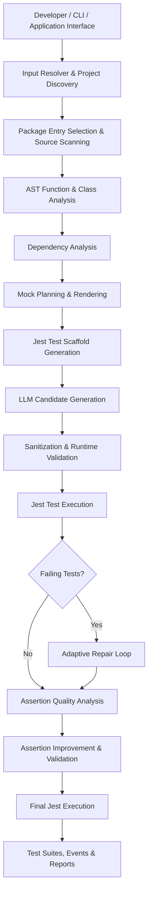

# UnitGen

### A Unified Framework for Verification & Improvement of LLM-Based Automated Unit Test Generation

**Generate. Verify. Repair. Improve.**


---

> **Generating a unit test is easy. Generating a unit test that actually runs, verifies meaningful behavior, survives execution, and helps developers trust their code is a much harder problem.**
>
> **UnitGen was built to tackle that problem.**

UnitGen is a modular, LLM-powered automated unit test generation framework for JavaScript and Node.js applications. It combines static code analysis, dependency-aware mocking, intelligent test generation, runtime verification, adaptive failure repair, and assertion quality enhancement into a unified testing pipeline.

Instead of simply asking an AI model to generate tests and saving whatever it produces, UnitGen takes generated tests through multiple verification and improvement stages.

It analyzes the source code, identifies testable functions and classes, investigates dependencies, prepares executable test scaffolds, generates candidate test cases, validates them through actual execution, attempts to repair failures, evaluates assertion quality, and produces the final test suite alongside execution reports.

The result is a research-oriented framework designed to move automated test generation beyond **code generation alone** toward executable, verifiable, and more reliable unit tests.

## Research at a Glance

UnitGen has completed an experimental evaluation across **25 real-world NPM packages**, following the benchmark package set used in the TestPilot research.

| Evaluation Metric | Result |
|---|---:|
| NPM packages evaluated | **25** |
| Total test candidates evaluated | **8,387** |
| Passing test candidates | **7,125** |
| Failed / rejected candidates | **1,262** |
| Overall candidate passing rate | **84.95%** |
| Primary testing framework | Jest |
| Target ecosystem | JavaScript / Node.js |
| Evaluation coverage metrics | Statement & Branch Coverage |

**84.95% of the evaluated test candidates passed**, demonstrating the framework's ability to produce and validate executable tests across a diverse collection of real-world JavaScript packages.

These figures represent the aggregate experimental evaluation. Candidate failures and rejections remain part of the recorded results rather than being hidden or counted as successes.

---

## Table of Contents

1. [The Problem](#the-problem)
2. [Why UnitGen?](#why-unitgen)
3. [Project Objectives](#project-objectives)
4. [System Architecture](#system-architecture)
5. [End-to-End Workflow](#end-to-end-workflow)
6. [Core Modules and Implementation](#core-modules-and-implementation)
7. [Key Features](#key-features)
8. [Technology Stack](#technology-stack)
9. [Project Structure](#project-structure)
10. [Installation and Setup](#installation-and-setup)
11. [Running UnitGen](#running-unitgen)
12. [Understanding the Results](#understanding-the-results)
13. [Research Evaluation and Benchmarking](#research-evaluation-and-benchmarking)
14. [UnitGen and TestPilot](#unitgen-and-testpilot)
15. [Engineering Challenges](#engineering-challenges)
16. [Limitations](#limitations)
17. [Future Directions](#future-directions)
18. [Research Significance](#research-significance)
19. [Project Team](#project-team)
20. [Acknowledgments](#acknowledgments)

---

## The Problem

### AI can write tests. But can we trust the tests it writes?

Large Language Models have transformed software development. They can understand source code, suggest implementations, explain complex algorithms, and generate unit tests within seconds.

However, automatically generated unit tests introduce several practical challenges.

**A test that looks correct is not necessarily executable. An executable test is not necessarily meaningful. And a passing test does not necessarily detect real faults.**

Some of the major challenges include:

**1. Non-executable generated tests**

LLMs can produce tests containing incorrect imports, nonexistent functions, invalid assumptions, unsupported dependencies, or syntactically incorrect JavaScript.

**2. External dependency complexity**

Real-world applications depend on APIs, file systems, databases, packages, and environment-specific resources. Generated unit tests may fail when these dependencies are not isolated or configured correctly.

**3. Limited failure recovery**

Many basic generation approaches stop after producing a candidate test. If the test fails, developers must manually investigate and repair it.

**4. Weak or trivial assertions**

Assertions such as:

```javascript
expect(result).toBeDefined();
```

may confirm that a value exists without verifying whether the function behaved correctly.

**5. Complex JavaScript APIs**

JavaScript packages expose functionality through multiple patterns, including named exports, default exports, CommonJS modules, classes, prototypes, and dynamically constructed API objects.

These patterns make identifying testable functions and constructing valid tests significantly more challenging.

**6. Fragmented testing workflows**

Static analysis, test generation, execution, repair, and quality improvement are often treated as separate activities.

UnitGen addresses these challenges by bringing them together into one coordinated workflow.

## Why UnitGen?

Most basic AI test-generation workflows follow a simple process:

```text
Source Code
    |
    v
LLM
    |
    v
Generated Tests
    |
    v
Done
```

But what happens if those tests fail?

What happens if an imported module cannot be resolved?

What happens if a generated assertion is meaningless?

What happens if the test is syntactically valid but cannot execute?

**UnitGen treats generating a test as the beginning of the process, not the finish line.**

Its workflow is designed around a more complete cycle:

```text
Understand the Code
        |
        v
Identify Testable Targets
        |
        v
Analyze Dependencies
        |
        v
Prepare Mocks & Test Scaffolds
        |
        v
Generate Test Candidates with an LLM
        |
        v
Validate Candidate Tests
        |
        v
Execute with Jest
        |
        v
Diagnose & Repair Failures
        |
        v
Analyze & Improve Assertions
        |
        v
Re-execute and Report
```

This shift from generation-focused automation toward **verification-driven test generation** forms the foundation of UnitGen.

---

## Project Objectives

UnitGen was developed around six major objectives.

### 1. Automate Function-Level Unit Test Generation

Analyze JavaScript source code and identify individual testable functions, classes, constructors, and methods.

### 2. Improve Test Executability

Use structured LLM prompting, test scaffolding, sanitization, runtime verification, and dependency handling to increase the likelihood that generated tests execute successfully.

### 3. Support Dependency-Aware Testing

Identify imported modules and external dependencies, then prepare suitable mocking strategies where isolation is necessary.

### 4. Automate Failure Diagnosis and Repair

Analyze failed tests, identify likely failure categories, and attempt to repair generated tests using automated repair strategies and LLM feedback.

### 5. Improve Assertion Quality

Detect weak assertions and evaluate possible replacements or improvements without blindly sacrificing test correctness.

### 6. Evaluate Reliability on Real-World Software

Benchmark the framework across the same 25 NPM packages used in TestPilot's empirical evaluation, measuring candidate passing behavior, statement coverage, and branch coverage.

---

## System Architecture

UnitGen follows a modular architecture in which each major responsibility is implemented through a dedicated component or group of components.

### High-Level Architecture



The system consists of several interconnected architectural layers.

| Layer | Responsibility |
|---|---|
| Developer Interface | Accept input, initiate execution, and present progress |
| Input & Discovery | Resolve project files and identify relevant package APIs |
| Static Analysis | Extract functions, classes, methods, and source metadata |
| Dependency & Mocking | Analyze imports, dependencies, and isolation requirements |
| Test Generation | Prepare Jest scaffolds and request candidate tests from an LLM |
| Runtime Verification | Sanitize, validate, and execute generated candidates |
| Adaptive Repair | Classify failures and attempt corrective transformations |
| Assertion Enhancement | Detect and improve weak assertions where possible |
| Reporting | Produce execution summaries, test artifacts, and structured results |

Each layer is intended to remain independently understandable and maintainable while contributing to the overall pipeline.

---

## End-to-End Workflow

### Stage 1 — Input Resolution and Project Discovery

UnitGen begins by resolving the developer's input.

Supported input workflows include:

- Individual JavaScript source files
- JavaScript source folders
- Node.js project directories
- Locally available NPM package source directories

For package inputs, UnitGen examines the project's structure and package metadata to identify appropriate source entry points.

The input resolver distinguishes between single-file inputs and project folders, allowing the pipeline to select an appropriate discovery strategy.

### Stage 2 — Public API Discovery and Function Extraction

UnitGen analyzes JavaScript code using Babel-based Abstract Syntax Tree (AST) processing.

The extraction process identifies relevant information such as:

- Function names
- Function parameters
- Source definitions
- Export information
- Asynchronous function indicators
- Class-like functions
- Constructors
- Prototype methods
- Static methods

For package inputs, the pipeline also includes entry-point selection, public-entry expansion, and conditional fallback strategies.

These mechanisms are important because real-world packages expose functionality differently.

For example:

```javascript
function calculateTotal(price, quantity) {
    return price * quantity;
}

module.exports = { calculateTotal };
```

Another package might use an ES module:

```javascript
export const calculateTotal = (price, quantity) => {
    return price * quantity;
};
```

A third package might expose class-based functionality:

```javascript
export class Calculator {
    add(a, b) {
        return a + b;
    }

    subtract(a, b) {
        return a - b;
    }
}
```

The extraction and class-analysis components help UnitGen construct appropriate testing targets for different JavaScript structures.

### Stage 3 — Documentation and Usage Context Collection

Generating useful tests requires more than knowing a function's name.

UnitGen includes context-extraction components that collect relevant information from available source code and project documentation.

These components include:

- Documentation comment extraction
- JSDoc analysis
- Usage snippet mining
- Function parameter metadata
- Function source definitions

The information is used to provide additional context during test generation.

For example, the function signature:

```javascript
function normalizeEmail(email)
```

provides limited information about expected behavior.

A documentation comment describing trimming, case normalization, and validation can give the LLM more useful context for generating appropriate tests.

This approach helps make test generation more context-aware.

### Stage 4 — Dependency Detection

Before generating test code, UnitGen investigates the dependencies associated with each target.

The dependency analysis layer examines imported identifiers and their usage.

It can identify patterns involving:

- Imported modules
- Imported functions
- Member access
- Function calls
- Constructor usage
- External library references
- Local module dependencies
- Relevant global APIs

This analysis produces structured dependency information for downstream mocking and generation components.

### Stage 5 — Mock Planning and Generation

External dependencies can make unit tests unreliable, expensive, or difficult to execute.

UnitGen includes a mocking pipeline that analyzes dependency information and produces suitable mock plans.

Its implementation distinguishes between dependency categories and considers whether mocking is appropriate.

For example, external systems involving network communication, databases, or remote services often require isolation.

In contrast, automatically mocking a pure mathematical utility may destroy the real behavior that a generated test should verify.

UnitGen therefore includes risk-based and dependency-availability considerations instead of indiscriminately mocking every imported library.

The mocking layer involves:

- Dependency classification
- Import analysis
- Mock plan construction
- Jest mock rendering
- Conditional handling of missing external modules
- Preparation of mock code for generated tests

**The objective is to reduce avoidable dependency-related failures without unnecessarily replacing real application behavior.**

### Stage 6 — Jest Test Scaffold Generation

For every selected target, UnitGen prepares a Jest-based testing scaffold.

The scaffold establishes the initial executable structure of a unit test.

A simplified example:

```javascript
import { calculateTotal } from "../src/calculator.js";

describe("calculateTotal", () => {
    test("calculates the total price", () => {
        const result = calculateTotal(100, 3);

        expect(result).toBe(300);
    });
});
```

Actual generated scaffolds may contain additional imports, mock initialization, class construction, and other supporting code.

The framework prepares the necessary testing context before candidate generation.

### Stage 7 — LLM-Powered Test Generation

Once the target and testing context are prepared, UnitGen uses an LLM to generate candidate test cases.

The generation process can use:

- Target name and signature
- Function implementation
- Parameter information
- Available documentation
- Usage examples
- Class and method context
- Dependency metadata
- Existing Jest scaffold

The objective is to generate test cases that exercise meaningful functionality rather than merely producing syntactically plausible test code.

A single function may receive multiple candidate cases.

These candidates proceed through further validation before being accepted into generated test files.

### Stage 8 — Candidate Sanitization

LLM output cannot be assumed correct.

UnitGen includes sanitization and validation logic to identify problematic candidate tests.

Examples of potential issues include:

- Invalid JavaScript syntax
- Undeclared references
- Duplicate candidate tests
- Unsupported test constructs
- Incorrect assertion structures
- Malformed candidate statements
- Invalid assumptions about target functions

Problematic candidates can be rejected before they affect the final test suite.

This separates *candidate generation* from *candidate acceptance*.

### Stage 9 — Runtime Candidate Validation

Passing a syntax check does not guarantee that a test works.

UnitGen performs runtime validation of candidate tests to determine whether they execute successfully.

The pipeline tracks candidate outcomes, including successful executions and different rejection or failure categories.

It also includes fallback-generation and repair-candidate handling for cases where initial candidate tests are unsuitable.

A central design principle is that generated tests should be evaluated using real execution feedback rather than accepted solely on the basis of LLM output.

### Stage 10 — Automated Jest Execution

UnitGen executes the generated test suite using Jest.

The execution engine collects information such as:

- Total test suites
- Passed and failed suites
- Total test cases
- Passing test cases
- Failing test cases
- Runtime and assertion failures
- Relevant diagnostic details

These results become the input for the adaptive repair stage.

### Stage 11 — Adaptive Repair Loop

When tests fail, UnitGen attempts to diagnose and correct the problem.

The repair system includes multiple strategies:

**AST-Based Repair**

Attempts structural corrections to generated test code where the failure pattern permits a local transformation.

**Semantic Repair**

Investigates common semantic problems, such as incorrect references or incompatible test constructions.

**LLM-Guided Repair**

Uses the failing test and execution feedback to request a corrected test implementation.

The repair process is iterative and bounded.

After a repair attempt, the framework can execute the tests again to evaluate whether the modification improved the result.

This approach transforms runtime errors from passive failure reports into potential feedback for automated improvement.

Importantly, a repair attempt is not automatically considered successful simply because modified code was produced.

### Stage 12 — Assertion Quality Enhancement

A test can execute successfully while still checking very little.

Consider:

```javascript
const result = calculateTotal(100, 3);

expect(result).toBeDefined();
```

This assertion confirms the presence of a value, but does not verify the expected calculation.

A more behavior-specific assertion would be:

```javascript
const result = calculateTotal(100, 3);

expect(result).toBe(300);
```

UnitGen includes an assertion enhancement subsystem designed to identify weak assertions and investigate stronger alternatives.

Its mechanisms include:

- Assertion analysis and detection
- AST-based transformations
- Runtime-aware validation where possible
- Evaluation of proposed replacements
- Rejection or rollback when a proposed improvement does not help

The framework is designed to avoid accepting every assertion transformation blindly.

### Stage 13 — Final Verification and Reporting

After repair and assertion processing, UnitGen performs final test execution and generates its output artifacts.

The final stage produces:

- Generated Jest test files
- Test execution summaries
- Pass/fail information
- Diagnostic output
- Structured final reporting
- Pipeline events for interface integration

The result is a complete testing workflow rather than a collection of unverified LLM responses.

---

## Core Modules and Implementation

UnitGen's backend uses a modular architecture centered around `src/index.js`, which coordinates the major pipeline stages.

| Module | Key Responsibility |
|---|---|
| `resolveInput.js` | Input discovery and validation |
| `parseFile.js` | JavaScript parsing |
| `functionExtractor.js` | AST-based function extraction |
| `classExportAnalyzer.js` | Class, constructor, and method analysis |
| `dynamicApiTestGenerator.js` | Conditional dynamic API discovery and generation |
| `packagePublicEntryExpander.js` | Expansion of public package entry points |
| `dependencyDetector.js` | Import and dependency usage analysis |
| `mockPlanBuilder.js` | Construction of dependency mock plans |
| `jestMockRenderer.js` | Rendering Jest-compatible mock code |
| `jestTestTemplate.js` | Generation of test scaffolds |
| `testWriter.js` | Writing generated test artifacts |
| `llmFillTests.js` | LLM candidate generation and injection |
| `generatedTestPreflight.js` | Generated test preflight support |
| `jestRunner.js` | Jest execution |
| `repairLoop.js` | Adaptive test repair orchestration |
| `assertionEnhancer.js` | Assertion improvement orchestration |
| `usageSnippetMiner.js` | Usage example extraction |
| `docCommentExtractor.js` | Documentation context extraction |
| `consoleReport.js` | Terminal execution reporting |
| `finalReportWriter.js` | Structured final result reporting |
| `runtimeArtifactCleanup.js` | Runtime artifact cleanup |

### Modular by Design

The responsibilities of source analysis, test generation, execution, repair, and assertion improvement are separated.

This makes the framework easier to extend, debug, test, and evaluate.

It also supports a fundamental engineering requirement of the project:

**Improvements should address general pipeline behavior rather than introduce special-case logic for individual benchmark packages.**

---

## Key Features

### AST-Based Source Intelligence

Extracts function-level metadata from JavaScript source code and supports class-aware analysis.

### Package-Aware Discovery

Uses project metadata, public entry points, expansion strategies, and conditional fallback mechanisms to identify suitable testing targets.

### Context-Enriched LLM Generation

Combines source code, signatures, usage examples, and documentation to support test synthesis.

### Dependency-Aware Mocking

Plans and renders mocks while considering dependency risk and whether real library behavior should be preserved.

### Runtime-Validated Candidate Generation

Evaluates candidate tests through sanitization and execution before determining which candidates to inject.

### Failure Classification

Provides diagnostic information that can guide corrective repair strategies.

### Multi-Strategy Adaptive Repair

Combines AST-based, semantic, and LLM-driven repair approaches.

### Assertion Quality Improvement

Identifies weak assertions and attempts stronger alternatives, with evaluation and rollback safeguards.

### Structured Reporting

Produces test execution summaries and final reports to support debugging and research evaluation.

### Developer-Oriented Interface Integration

The project includes application-facing development work alongside the backend, with structured execution events that can support progress displays, failure diagnostics, and result presentation.

### Real-World Research Benchmarking

Evaluated against a benchmark set of 25 NPM packages used in existing academic research.

---

## Technology Stack

| Category | Technology |
|---|---|
| Primary Language | JavaScript (ES6+) |
| Runtime | Node.js |
| Package Management | npm |
| Parsing & Static Analysis | Babel Parser / Traverse |
| AI Test Generation | Large Language Models |
| LLM Configuration | OpenAI model configuration |
| Test Framework | Jest |
| Mocking | Jest Mocks |
| Repair Techniques | AST-Based, Semantic, LLM-Guided |
| Documentation Analysis | JSDoc and Markdown Usage Mining |
| Data Representation | JavaScript Objects / JSON |
| Development Environment | Visual Studio Code |
| Source Control | Git / GitHub |
| Research Evaluation | Passing Rate, Statement Coverage, Branch Coverage |

### Why These Technologies?

**JavaScript and Node.js** provide native compatibility with the target package ecosystem.

**Babel** enables structured source-code analysis, including function, class, and export metadata.

**LLMs** provide generative capabilities for creating tests based on the implementation and available context.

**Jest** provides an execution environment for validating generated unit tests.

**AST and Semantic Repair** enable structured correction strategies that can complement LLM-based repairs.

**JSON-based Reporting** provides a practical way to record hierarchical execution results and pipeline diagnostics.

---

## Project Structure

The backend source is organized around the following major components:

```text
UnitGen/
│
├── backend/
│   │
│   ├── src/
│   │   ├── index.js
│   │   │
│   │   └── core/
│   │       │
│   │       ├── input/
│   │       │   └── resolveInput.js
│   │       │
│   │       ├── parser/
│   │       │   ├── parseFile.js
│   │       │   ├── functionExtractor.js
│   │       │   ├── classExportAnalyzer.js
│   │       │   ├── dynamicApiTestGenerator.js
│   │       │   └── packagePublicEntryExpander.js
│   │       │
│   │       ├── dependency/
│   │       │   └── dependencyDetector.js
│   │       │
│   │       ├── mock/
│   │       │   ├── mockPlanBuilder.js
│   │       │   └── jestMockRenderer.js
│   │       │
│   │       ├── testgen/
│   │       │   ├── jestTestTemplate.js
│   │       │   ├── testWriter.js
│   │       │   ├── generatedTestPreflight.js
│   │       │   └── runtimeArtifactCleanup.js
│   │       │
│   │       ├── llm/
│   │       │   └── llmFillTests.js
│   │       │
│   │       ├── context/
│   │       │   ├── usageSnippetMiner.js
│   │       │   └── docCommentExtractor.js
│   │       │
│   │       ├── runner/
│   │       │   └── jestRunner.js
│   │       │
│   │       ├── repair/
│   │       │   └── repairLoop.js
│   │       │
│   │       ├── assertion/
│   │       │   └── assertionEnhancer.js
│   │       │
│   │       └── report/
│   │           ├── consoleReport.js
│   │           └── finalReportWriter.js
│   │
│   ├── benchmark_packages/
│   │   └── ...
│   │
│   ├── tests/
│   │   └── generated/
│   │
│   └── package.json
│
└── README.md
```

*This is a condensed architectural directory map. It highlights the verified backend components rather than listing every source file, frontend asset, or installed dependency.*

---

## Installation and Setup

### Prerequisites

Before running the backend, ensure that you have:

- Node.js and npm installed
- A compatible development environment
- Access to the required LLM provider
- Appropriate credentials for the configured LLM
- The source code or project you intend to analyze

### Step 1 — Clone the Repository

Clone the UnitGen repository using your GitHub repository URL.

```bash
git clone <your-unitgen-repository-url>
cd UnitGen
```

### Step 2 — Navigate to the Backend

```bash
cd backend
```

### Step 3 — Install Dependencies

```bash
npm install
```

This installs the backend dependencies declared in `package.json`.

### Step 4 — Configure the LLM

Create the appropriate environment configuration for the LLM provider used by your backend.

For an OpenAI-based configuration, typical settings include:

```env
OPENAI_API_KEY=your_openai_api_key
OPENAI_MODEL=gpt-3.5-turbo
```

The model identifier should correspond to a model available to your API account.

UnitGen's main backend also supports the following configuration for top-level external dependency mocking:

```env
UNITGEN_MOCK_TOP_LEVEL_EXTERNALS=true
```

When enabled, the backend applies its risk and dependency-availability filtering when deciding which top-level external imports require mocking.

**Never commit API keys or other secrets to GitHub.**

### Step 5 — Prepare the Input

Place the package or project to be analyzed in an accessible directory.

For benchmark evaluation, package directories can be placed inside:

```text
backend/benchmark_packages/
```

Dependencies required by the selected package should be available in the intended testing environment.

---

## Running UnitGen

### Run an NPM Benchmark Package

From the backend directory:

```bash
npm start -- benchmark_packages/geo-point
```

Or on Windows:

```powershell
npm start -- benchmark_packages\geo-point
```

### Run Another JavaScript Project

```bash
npm start -- path/to/your/project
```

### Run a JavaScript File

```bash
npm start -- path/to/your/file.js
```

### Capture the Complete Execution Output

For Windows PowerShell:

```powershell
npm start -- benchmark_packages\geo-point 2>&1 |
    Tee-Object -FilePath geo-point-output.txt
```

This displays the output in the terminal while saving it to a text file.

To save the output without printing it to the terminal:

```powershell
npm start -- benchmark_packages\geo-point > geo-point-output.txt 2>&1
```

### Generated Test Files

Generated Jest test files are written to the backend's generated-test directory:

```text
backend/tests/generated/
```

UnitGen also produces execution diagnostics and structured reporting through its reporting components.

Generated artifacts should be reviewed before inclusion in a production project's permanent test suite.

---

## Understanding the Results

UnitGen's terminal reporting allows developers to inspect how each major stage performs.

### Function Extraction

The extraction stage reports detected functions and selected test targets.

For class-like exports, additional class and method information may be displayed.

### Dependency Analysis

The dependency stage reports imported modules and relevant usage information.

### Mock Planning

The mock planner identifies dependencies selected for mocking and the available mock plan.

### LLM Injection Summary

For candidate-generation attempts that reach the detailed validation workflow, UnitGen can report information such as:

```text
LLM injection summary
   received: ...
   sanitizer accepted: ...
   sanitizer rejected: ...
   duplicates: ...
   runtime attempted: ...
   runtime passed: ...
   runtime failed: ...
   runtime repair candidates available: ...
   runtime repair candidates injected: ...
   fallback runtime attempted: ...
   fallback runtime passed: ...
   final injected: ...
```

These diagnostics help distinguish generated candidate volume from accepted and executable tests.

### Jest Results

Jest execution reports summarize final test behavior.

A simplified example:

```text
UnitGen Test Report
-------------------------------
Total Test Suites : ...
Failed Suites     : ...
Total Tests       : ...
Passed            : ...
Failed            : ...
-------------------------------
```

### Adaptive Repair Results

The repair stage provides failure classifications, repair attempts, and relevant diagnostic output.

### Assertion Enhancement Results

The assertion enhancement stage can report:

- Detected weak assertions
- Proposed transformations
- Validation outcomes
- Accepted improvements
- Rejected and reverted changes

### Important Distinction

**Generated test files, test candidates, and final Jest test cases are not interchangeable metrics.**

One generated test file may contain multiple test cases. Candidate tests may also be rejected during sanitization or execution validation.

Research analysis should therefore report each quantity using its correct definition.

---

## Research Evaluation and Benchmarking

### Experimental Motivation

UnitGen was inspired by TestPilot, a research-based tool for automated JavaScript unit test generation.

TestPilot demonstrated that off-the-shelf LLMs can produce useful test cases for real-world software using dynamically discovered APIs and adaptive prompting.

UnitGen extends the investigation toward a more comprehensive verification-oriented workflow, incorporating dependency handling, structured repair, runtime candidate validation, and assertion enhancement.

### Benchmark Dataset

The evaluation uses **25 real-world NPM packages from the TestPilot benchmark set**.

The tested ecosystem includes packages representing different JavaScript programming patterns and application domains.

Examples from the benchmark include:

| Package | Representative Domain |
|---|---|
| `complex.js` | Complex number operations |
| `countries-and-timezones` | Country and timezone utilities |
| `geo-point` | Geographic coordinate calculations |
| `jsonfile` | JSON file operations |
| `fs-extra` | File system utilities |
| `memfs` | In-memory file system |
| `js-sdsl` | JavaScript data structures |
| `quill-delta` | Delta-based document operations |
| `glob` | File path pattern matching |
| `q` | Promise-based asynchronous programming |
| `bluebird` | Promise utilities |
| `rsvp` | Promise and asynchronous utilities |

The complete evaluation covers the 25-package benchmark set, not just the examples listed above.

### Evaluation Methodology

The experimental workflow involves:

1. Preparing each benchmark package.
2. Running UnitGen against the package source.
3. Recording generated test candidates.
4. Tracking candidate validation and execution outcomes.
5. Collecting final test execution results.
6. Performing statement and branch coverage analysis.
7. Consolidating the package-level results.
8. Comparing the obtained measurements with the TestPilot research.

The evaluation emphasizes both the ability to generate executable tests and the behavior of the framework across varied JavaScript inputs.

### Aggregate Evaluation Results

| Metric | Value |
|---|---:|
| Total benchmark packages | 25 |
| Total candidates evaluated | 8,387 |
| Passing candidates | 7,125 |
| Failed / rejected candidates | 1,262 |
| Candidate passing rate | 84.95% |
| Candidate non-passing rate | 15.05% |

The passing rate is calculated as:

\[
\text{Passing Rate} =
\frac{\text{Passing Candidates}}{\text{Total Evaluated Candidates}}
\times 100
\]

\[
=
\frac{7125}{8387}\times100
\approx 84.95\%
\]

### Interpretation

The results indicate that UnitGen was able to process and evaluate thousands of candidate tests across a diverse package collection.

The aggregate candidate passing rate of **84.95%** provides evidence of executable candidate generation and validation at scale.

However, this metric should not be interpreted as:

- 84.95% statement coverage
- 84.95% branch coverage
- 84.95% defect-detection accuracy
- A guarantee that 84.95% of tests will pass on every new project

These are different measurements with different interpretations.

### Statement and Branch Coverage

Statement and branch coverage are used in UnitGen's experimental evaluation to measure how thoroughly generated tests execute the code under test.

**Statement Coverage** measures the proportion of executable statements exercised by the test suite.

**Branch Coverage** measures the proportion of program control-flow branches exercised by the test suite.

Coverage is calculated in the separate experimental evaluation process rather than presented as an integrated optimization mechanism inside the UnitGen runtime pipeline.

This distinction is important for accurately representing the implemented system and its research methodology.

### Research Reproducibility

Meaningful comparison between automated test-generation systems requires controlling important experimental conditions.

These include:

- Benchmark package identities and versions
- JavaScript runtime compatibility
- LLM provider and model configuration
- Prompting and generation settings
- Test execution environment
- Retry limits and validation policies
- Coverage instrumentation
- Candidate-counting methodology

TestPilot's published results serve as a research baseline, but a claim of statistically or experimentally superior performance requires a comparison under appropriately documented and comparable conditions.

---

## UnitGen and TestPilot

### Research Foundation

UnitGen draws inspiration from the research paper:

**An Empirical Evaluation of Using Large Language Models for Automated Unit Test Generation**

The paper introduces and evaluates TestPilot, an automated JavaScript test-generation approach centered around API discovery, contextual prompting, test validation, and adaptive prompt refinement.

### Architectural Comparison

| Aspect | TestPilot | UnitGen |
|---|---|---|
| Primary Target | JavaScript NPM packages | JavaScript and Node.js inputs |
| API Analysis | Dynamic API exploration | AST analysis, class analysis, conditional dynamic discovery |
| Documentation Context | Documentation mining | Documentation comments and usage snippet mining |
| Test Generation | LLM-based test generation | LLM-based candidate generation with Jest scaffolds |
| Test Framework | Mocha | Jest |
| Dependency Mocking | Not a central component | Dedicated dependency and mock planning |
| Validation | Syntax and runtime validation | Sanitization, candidate runtime validation, and Jest execution |
| Failure Improvement | Adaptive prompt refinement | AST, semantic, and LLM-guided repair |
| Assertion Quality | Non-trivial assertion evaluation in research | Integrated weak assertion analysis and enhancement |
| Developer Experience | Research-oriented tooling | Backend pipeline with developer-facing application integration |
| Benchmarking | 25 NPM packages | Evaluation on the same 25-package benchmark set |

### What Makes UnitGen Different?

**1. Verification is integrated into the generation workflow.**

Generated candidates are evaluated rather than automatically trusted.

**2. Dependency management is treated as a dedicated concern.**

The framework analyzes dependencies and prepares mock strategies instead of relying exclusively on an LLM to account for the execution environment.

**3. Repair uses multiple strategies.**

The implementation combines structural, semantic, and LLM-assisted correction approaches.

**4. Assertion quality is part of the runtime pipeline.**

Weak assertions are investigated through a dedicated enhancement stage.

**5. The framework is designed around modularity.**

Individual components can be investigated and improved without redesigning the entire generation pipeline.

**6. Real-world benchmarking is central to validation.**

UnitGen has been evaluated against the 25-package research benchmark rather than only small demonstration examples.

UnitGen and TestPilot remain separate implementations. TestPilot serves as the academic reference point and benchmark for evaluation.

---

## Engineering Challenges

Building an automated test-generation framework involves more than connecting an LLM to a testing library.

Several engineering challenges shaped UnitGen's implementation.

### 1. JavaScript's Dynamic Export System

JavaScript packages may export functions through several patterns, including module objects, named exports, classes, and prototypes.

**Approach:** Combine AST-based extraction, class-aware analysis, package entry discovery, and conditional API discovery mechanisms.

### 2. Dependency Isolation Without Destroying Behavior

Mocking every dependency may make tests artificial, while mocking none can produce avoidable runtime failures.

**Approach:** Analyze dependency types and usage, then use conditional mock planning and rendering.

### 3. Unpredictable LLM Output

LLMs do not consistently produce correct code, valid assertions, or usable imports.

**Approach:** Apply sanitization, duplicate detection, runtime validation, and candidate acceptance logic before final test execution.

### 4. Failed Test Recovery

Different failures require different responses. A syntax error is not equivalent to an assertion mismatch or a missing dependency.

**Approach:** Use failure diagnostics to guide AST-based, semantic, and LLM-assisted repair strategies.

### 5. Avoiding Harmful Assertion Transformations

Automatically strengthening an assertion can introduce a new failure or incorrect assumption.

**Approach:** Validate proposed transformations and reject or revert changes that do not improve the targeted result.

### 6. Handling Diverse Real-World Packages

The benchmark includes packages with different APIs, module formats, dependency structures, and complexity levels.

**Approach:** Favor generalized pipeline mechanisms rather than package-specific hardcoded fixes.

### 7. Preserving Pipeline Reliability

A change that improves one package can unintentionally affect another.

**Approach:** Keep components modular, preserve working behavior where possible, and evaluate changes across representative inputs.

---

## Limitations

UnitGen is a research and engineering project, not a guarantee of perfect automated testing.

Its current limitations include:

**JavaScript-focused implementation**

The primary implementation targets JavaScript and Node.js. Other programming languages would require additional parsing, generation, and execution support.

**LLM dependency**

Test generation quality depends partly on the selected model, available context, response quality, and external provider availability.

**External execution dependencies**

Some packages require environment-specific configuration, dependencies, files, or runtime resources.

**Incomplete test executability**

Not every generated test candidate passes. Candidate failures are an expected and measurable part of automated test generation.

**Heuristic analysis and repair**

AST discovery, dependency analysis, mocking, and repair strategies cannot guarantee correct behavior for every possible JavaScript program.

**Test quality is not guaranteed by passing status**

A passing test may still contain an insufficient assertion or exercise limited program behavior.

**Coverage is evaluated separately**

Statement and branch coverage belong to the experimental evaluation process and are not part of the runtime pipeline's integrated coverage optimization.

**No implemented mutation-score evaluation**

The reported UnitGen evaluation uses candidate passing rate, statement coverage, and branch coverage. Mutation score is not claimed as an implemented experimental metric.

**Generated test code requires appropriate execution safeguards**

Developers should execute generated tests and unfamiliar packages in controlled environments, especially when source code can access files, processes, networks, or external resources.

These limitations are important for transparent research reporting and responsible interpretation of results.

---

## Future Directions

UnitGen provides a foundation for additional software testing research.

Potential future directions include:

- Broader language and framework support
- Improved handling of complex asynchronous behavior
- More robust dependency isolation
- Expanded dynamic API analysis
- Improved test diversity and edge-case generation
- CI/CD integration
- Additional feedback-driven generation strategies
- Advanced assertion quality evaluation
- More extensive fault-detection evaluation
- Automated benchmark reproducibility tooling
- Broader cross-project generalization studies

These are research and development directions rather than claims about functionality already delivered.

---

## Research Significance

UnitGen explores an important question at the intersection of **Software Engineering, Automated Testing, and Generative Artificial Intelligence**:

> Can we make AI-generated unit tests more useful by combining code understanding, dependency handling, runtime verification, automated repair, and assertion improvement in a unified system?

The project demonstrates an implementation of this approach and evaluates its behavior on real-world JavaScript packages.

Its contributions include:

**A unified architecture** combining generation, verification, repair, and assertion improvement.

**A modular implementation** supporting independent investigation of major testing components.

**A verification-oriented workflow** that does not assume LLM-generated candidates are automatically correct.

**An experimental evaluation** covering 8,387 candidates across 25 NPM packages.

**A reproducible research direction** grounded in the established TestPilot benchmark and measurable execution and coverage outcomes.

The broader objective is to reduce the manual effort involved in creating usable tests while preserving the need for meaningful behavioral verification.

---

## Project Team

**UnitGen — Final Year Project**

Developed at **Capital University of Science & Technology (CUST), Islamabad, Pakistan**, as a Software Engineering Final Year Project.

**Project Contributors**

- Syed Mukhtar Ul Hassan
- Muhammad Abbas
- Muhammad Hammad Ali

The project brings together practical software engineering, automated testing, static program analysis, and LLM-based code generation.

## Acknowledgments

We acknowledge the researchers behind **TestPilot** and the paper *An Empirical Evaluation of Using Large Language Models for Automated Unit Test Generation* for providing an important research foundation and benchmark reference.

We also acknowledge the open-source technologies that support UnitGen, including Node.js, Babel, Jest, and the broader JavaScript ecosystem.

Special thanks to our academic supervisor and faculty for their guidance throughout the research, development, and evaluation process.

---

## Final Perspective

Unit testing is not just about generating more test cases.

It is about generating tests that developers can execute, evaluate, improve, and use to understand whether their software behaves correctly.

UnitGen was built around that principle.

With **8,387 evaluated candidates across 25 real-world NPM packages and an overall candidate passing rate of 84.95%**, the project represents a practical investigation into verification-driven, LLM-based automated unit test generation.

Its central idea remains simple:

**Don't just generate tests. Verify them. Repair them. Improve them.**

**UnitGen — Beyond Test Generation. Toward Test Reliability.**

---

*Built with JavaScript, Node.js, Babel, Jest, and Large Language Models.*

*Developed as a research-driven Software Engineering Final Year Project.*
