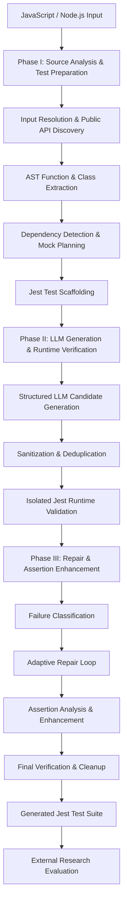

# UnitGen

### A Unified Framework for Verification & Improvement of LLM-Based Automated Unit Test Generation

**Generate. Verify. Repair. Improve.**


---

> **Generating a unit test is easy. Generating a unit test that actually runs, verifies meaningful behavior, survives execution, and helps developers trust their code is a much harder problem.**
>
> **UnitGen was built to tackle that problem.**

UnitGen is a modular, LLM-powered automated unit test generation framework for JavaScript and Node.js applications. It combines static code analysis, public API discovery, dependency-aware mocking, intelligent test generation, runtime verification, adaptive failure repair, and assertion quality enhancement into a unified testing pipeline.

Instead of simply asking an AI model to generate tests and saving whatever it produces, UnitGen takes generated tests through multiple verification and improvement stages.

It analyzes source code, identifies testable functions and classes, investigates dependencies, prepares executable test scaffolds, generates candidate test cases, validates them through actual execution, attempts to repair failures, evaluates assertion quality, and produces the final Jest test suite alongside execution reports.

Developed as both a **research framework and a local desktop application**, UnitGen integrates an Electron-based interface with a modular Node.js backend.

The result is a verification-oriented system designed to move automated test generation beyond code generation alone toward executable, verifiable, and more reliable unit tests.

---

## Research at a Glance

UnitGen was experimentally evaluated across **25 real-world npm packages**, using the benchmark package set established by TestPilot.

| Evaluation Metric | UnitGen Result |
|---|---:|
| npm packages evaluated | **25** |
| Generated tests evaluated | **8,387** |
| Passing tests | **7,125** |
| Failing tests | **1,262** |
| Aggregate test passing rate | **84.95%** |
| Median package passing rate | **83.28%** |
| Median statement coverage | **80.00%** |
| Median branch coverage | **62.50%** |
| Primary testing framework | Jest |
| Target ecosystem | JavaScript / Node.js |

### Coverage Comparison with TestPilot

| Metric | UnitGen | TestPilot | Difference |
|---|---:|---:|---:|
| Median test passing rate | **83.28%** | 48.00% | +35.28 pp |
| Median statement coverage | **80.00%** | 70.20% | +9.80 pp |
| Median branch coverage | **62.50%** | 52.80% | +9.70 pp |

**UnitGen achieved 84.95% aggregate test passing behavior**, while its generated passing tests reached higher median statement and branch coverage than the published TestPilot baseline on the evaluated package set.

The median statement-coverage difference corresponds to approximately **13.96% relative improvement**, while the median branch-coverage difference corresponds to approximately **18.37% relative improvement**.

These are the results reported in the UnitGen research evaluation. They should be interpreted with the experimental qualifications explained later in this README: TestPilot and UnitGen use different execution frameworks, and their evaluation procedures are not identical.

---

## Table of Contents

1. [The Problem](#the-problem)
2. [Why UnitGen?](#why-unitgen)
3. [Project Objectives](#project-objectives)
4. [System Architecture](#system-architecture)
5. [End-to-End Workflow](#end-to-end-workflow)
6. [Core Modules and Implementation](#core-modules-and-implementation)
7. [Key Features](#key-features)
8. [Technology Stack](#technology-stack)
9. [Desktop Application](#desktop-application)
10. [Project Structure](#project-structure)
11. [Installation and Setup](#installation-and-setup)
12. [Running UnitGen](#running-unitgen)
13. [Understanding the Results](#understanding-the-results)
14. [Research Evaluation and Benchmarking](#research-evaluation-and-benchmarking)
15. [Complete 25-Package Test Results](#complete-25-package-test-results)
16. [Statement and Branch Coverage Results](#statement-and-branch-coverage-results)
17. [Quill-Delta End-to-End Case Study](#quill-delta-end-to-end-case-study)
18. [UnitGen and TestPilot](#unitgen-and-testpilot)
19. [Engineering Challenges](#engineering-challenges)
20. [Limitations](#limitations)
21. [Future Directions](#future-directions)
22. [Research Significance](#research-significance)
23. [Project Team](#project-team)
24. [Research References](#research-references)
25. [Acknowledgments](#acknowledgments)

---

## The Problem

### AI can write tests. But can we trust the tests it writes?

Large Language Models have transformed software development. They can understand source code, suggest implementations, explain complex algorithms, and generate unit tests within seconds.

However, automatically generated unit tests introduce several practical challenges.

**A test that looks correct is not necessarily executable. An executable test is not necessarily meaningful. And a passing test does not necessarily detect real faults.**

Some of the major challenges include:

### 1. Non-Executable Generated Tests

LLMs can produce tests containing incorrect imports, nonexistent functions, invalid assumptions, unsupported dependencies, or syntactically incorrect JavaScript.

### 2. External Dependency Complexity

Real-world applications depend on APIs, file systems, databases, packages, and environment-specific resources. Generated unit tests may fail when these dependencies are not isolated or configured correctly.

### 3. Limited Failure Recovery

Many basic generation approaches stop after producing a candidate test. If the test fails, developers must manually investigate and repair it.

### 4. Weak or Trivial Assertions

Assertions such as:

```javascript
expect(result).toBeDefined();
```

may confirm that a value exists without verifying whether the function behaved correctly.

### 5. Complex JavaScript APIs

JavaScript packages expose functionality through multiple patterns, including named exports, default exports, CommonJS modules, classes, prototypes, nested objects, and dynamically constructed API objects.

These patterns make identifying testable functions and constructing valid tests significantly more challenging.

### 6. Fragmented Testing Workflows

Static analysis, test generation, execution, repair, and quality improvement are often treated as separate activities.

UnitGen addresses these challenges by bringing them together into one coordinated workflow.

---

## Why UnitGen?

Most basic AI test-generation workflows follow a simple process:

```text
Source Code
    |
    v
LLM
    |
    v
Generated Tests
    |
    v
Done
```

But what happens if those tests fail?

What happens if an imported module cannot be resolved?

What happens if a generated assertion is meaningless?

What happens if the test is syntactically valid but cannot execute?

**UnitGen treats generating a test as the beginning of the process, not the finish line.**

Its workflow is designed around a more complete cycle:

```text
Understand the Code
        |
        v
Identify Testable Targets
        |
        v
Analyze Dependencies
        |
        v
Prepare Mocks & Test Scaffolds
        |
        v
Generate Test Candidates
        |
        v
Sanitize & Validate
        |
        v
Execute with Jest
        |
        v
Diagnose & Repair Failures
        |
        v
Analyze & Improve Assertions
        |
        v
Finalize & Export Test Suite
```

This shift from generation-focused automation toward **verification-driven test generation** forms the foundation of UnitGen.

### The Core Philosophy

UnitGen follows a fundamental principle:

> **Probabilistic generation should be surrounded by deterministic analysis and executable verification rather than trusted as final output.**

The LLM proposes behavioral tests.

The surrounding framework determines whether those tests are structurally valid, executable, suitable for repair, and safe to retain.

---

## Project Objectives

UnitGen was developed around six major objectives.

### 1. Automate Function-Level Unit Test Generation

Analyze JavaScript source code and identify individual testable functions, classes, constructors, and methods.

### 2. Improve Test Executability

Use structured LLM prompting, test scaffolding, sanitization, runtime verification, and dependency handling to increase the likelihood that generated tests execute successfully.

### 3. Support Dependency-Aware Testing

Identify imported modules and external dependencies, then prepare suitable mocking strategies where isolation is necessary.

### 4. Automate Failure Diagnosis and Repair

Analyze failed tests, identify likely failure categories, and attempt to repair generated tests using automated repair strategies and execution feedback.

### 5. Improve Assertion Quality

Detect weak assertions and evaluate possible replacements or improvements without blindly sacrificing test correctness.

### 6. Evaluate Reliability on Real-World Software

Benchmark UnitGen on the same 25 npm packages used in TestPilot's empirical evaluation, measuring test passing behavior, statement coverage, and branch coverage.

---

## System Architecture

UnitGen follows a modular, three-phase research architecture implemented through a locally executed desktop application and backend engine.

### High-Level Architecture



### Architectural Layers

| Layer | Responsibility |
|---|---|
| Desktop Interface | Project selection, provider configuration, progress monitoring, and test export |
| Input & Discovery | Resolve project files and identify publicly testable APIs |
| Static Analysis | Extract functions, classes, methods, parameters, and source metadata |
| Dependency & Mocking | Analyze imports, dependencies, and isolation requirements |
| Test Generation | Prepare Jest scaffolds and obtain bounded candidate tests |
| Runtime Verification | Sanitize, deduplicate, validate, and execute candidates |
| Adaptive Repair | Classify failures and attempt corrective transformations |
| Assertion Enhancement | Detect and improve weak assertions where justified |
| Reporting & Export | Produce execution summaries, test files, and structured results |
| Research Evaluation | Measure passing rate, statement coverage, and branch coverage externally |

### Three-Phase Methodology

**Phase I — Source Analysis and Test Preparation**

Transforms source code or an npm package into testable public targets and dependency-aware Jest scaffolds.

**Phase II — LLM Test Generation and Runtime Verification**

Produces structured behavioral candidates and admits them only after deterministic screening and runtime validation.

**Phase III — Adaptive Repair and Assertion Enhancement**

Diagnoses remaining failures, attempts bounded repairs, analyzes assertion quality, validates modifications, and finalizes the test suite.

The research evaluation follows the completed operational pipeline and is not itself a test-generation stage.

---

## End-to-End Workflow

### Stage 1 — Input Resolution and Project Discovery

UnitGen begins by resolving the developer's input.

Supported input workflows include:

- Individual JavaScript source files
- JavaScript source folders
- Node.js project directories
- Locally available npm package source directories

For package inputs, UnitGen examines the project structure and package metadata to identify suitable source entry points.

The framework prioritizes package-owned implementation files and avoids unnecessary scanning of obvious vendor, minified, generated, or instrumentation artifacts.

### Stage 2 — Public API Discovery and Function Extraction

UnitGen analyzes JavaScript code using Babel-based Abstract Syntax Tree (AST) processing.

The extraction process identifies relevant information such as:

- Function names
- Function parameters
- Source definitions
- Export information
- Asynchronous function indicators
- Class-like functions
- Constructors
- Prototype methods
- Static methods
- Public invocation paths

For package inputs, the pipeline also includes public-entry selection, controlled entry expansion, conditional full scanning, and bounded dynamic API discovery.

These mechanisms address the variety of ways JavaScript packages expose functionality.

For example:

```javascript
function calculateTotal(price, quantity) {
    return price * quantity;
}

module.exports = { calculateTotal };
```

Another package might use an ES module:

```javascript
export const calculateTotal = (price, quantity) => {
    return price * quantity;
};
```

A third package might expose class-based functionality:

```javascript
export class Calculator {
    add(a, b) {
        return a + b;
    }

    subtract(a, b) {
        return a - b;
    }
}
```

UnitGen's extraction and class-analysis components help construct appropriate testing targets for these different structures.

#### Parameter Normalization

JavaScript functions can use default parameters, destructuring, rest parameters, and unnamed patterns.

UnitGen normalizes parameter information to provide a more consistent representation for downstream generation.

#### Asynchronous Behavior Analysis

The analysis records explicit asynchronous functions and recognizes supported Promise-related patterns.

This information influences test invocation and runtime handling.

### Stage 3 — Dynamic Public API Discovery

Static analysis cannot always recover APIs assembled dynamically.

Packages may expose functionality through:

- Runtime-created objects
- Nested exports
- Prototype methods
- Re-exported modules
- Dynamically assigned properties

UnitGen includes a bounded runtime public-API explorer that investigates reachable callable exports when appropriate.

The explorer preserves public access paths and applies depth and API-count limits to avoid uncontrolled traversal.

Static and dynamic targets are deduplicated so the same underlying functionality is not unnecessarily generated multiple times.

### Stage 4 — Documentation and Usage Context Collection

Generating useful tests requires more than knowing a function's name.

UnitGen collects available contextual information through:

- Documentation comment extraction
- JSDoc analysis
- Usage snippet mining
- Function parameter metadata
- Function source definitions

This information helps the LLM understand expected behavior and typical usage patterns.

For example, the signature:

```javascript
function normalizeEmail(email)
```

provides limited information about expected behavior.

Documentation describing trimming, case normalization, and validation can provide additional evidence for suitable test cases.

### Stage 5 — Dependency Detection

Before generating test code, UnitGen investigates dependencies associated with each target.

The dependency analysis identifies patterns involving:

- Imported modules
- Imported functions
- Function calls
- Member access
- Constructor usage
- External libraries
- Local modules
- Global APIs
- Transitive helper calls

Dependency analysis is target-specific rather than simply collecting every import from the source file.

When appropriate, the analyzer follows local helper calls to detect dependencies used indirectly by a public function.

The implemented methodology bounds transitive helper analysis to a maximum depth of three.

### Stage 6 — Mock Planning and Generation

External dependencies can make unit tests unreliable or difficult to execute.

UnitGen includes a mocking pipeline that analyzes dependency information and prepares suitable mock plans.

Dependencies are categorized as:

- Node.js built-in modules
- External npm packages
- Local project modules
- Global or virtual dependencies

UnitGen does not automatically mock every imported module.

Instead, it considers dependency characteristics and execution risks.

For example, external services involving network communication, databases, cloud resources, or payments may need isolation.

Conversely, resolvable deterministic utility libraries are generally preserved so tests exercise actual package behavior.

The mocking layer includes:

- Dependency classification
- Import analysis
- Target-specific mock planning
- Jest mock rendering
- Missing-dependency handling
- Mock-before-import preparation

**The objective is to reduce dependency-related failures without unnecessarily replacing the real behavior being tested.**

### Stage 7 — Jest Test Scaffold Generation

UnitGen prepares a Jest scaffold for each selected target.

A simplified example:

```javascript
import { calculateTotal } from "../src/calculator.js";

describe("calculateTotal", () => {
    test("calculates the total price", () => {
        const result = calculateTotal(100, 3);

        expect(result).toBe(300);
    });
});
```

Actual generated scaffolds may contain additional imports, mocking logic, class construction, and CommonJS/ES module compatibility handling.

The framework controls the surrounding test harness before requesting behavioral candidates from the LLM.

### Stage 8 — Structured LLM Test Generation

Once the target context and scaffold are prepared, UnitGen uses an LLM to generate candidate tests.

The generation context can include:

- Target identity and signature
- Function implementation
- Parameters and argument guidance
- Documentation
- Usage examples
- Class and method information
- Public access paths
- Dependency information
- Existing test scaffold

Instead of requesting an unrestricted Jest test file, UnitGen asks the LLM for structured test fragments.

The generation contract uses a structure resembling:

```json
{
  "title": "should calculate the correct total",
  "arrange": "const price = 100; const quantity = 3;",
  "act": "const result = calculateTotal(price, quantity);",
  "assert": "expect(result).toBe(300);"
}
```

The implemented research methodology requests six to eight candidate cases when suitable, emphasizing safe invariants, normal behavior, and supported parameterized inputs.

The LLM supplies behavioral proposals while UnitGen controls imports, mocks, suite structure, and source loading.

### Stage 9 — Candidate Sanitization and Deduplication

LLM output cannot be assumed correct.

UnitGen screens candidate tests for problems such as:

- Invalid JavaScript syntax
- Undeclared references
- Unsupported test constructs
- Duplicate cases
- Invalid result declarations
- Incorrect assertion structures
- Unsupported mock-call assertions
- Improper asynchronous matcher usage
- Unjustified throw expectations

Candidates that fail deterministic screening are rejected before runtime admission.

This establishes an important boundary between **candidate generation** and **candidate acceptance**.

### Stage 10 — Isolated Runtime Validation

Passing a syntax check does not guarantee a test works.

UnitGen temporarily inserts candidate tests into their prepared Jest scaffolds and executes them.

The validation process checks candidates together with previously accepted cases, helping identify interactions that might not be visible when each test is run independently.

The temporary file state is restored after validation attempts.

Runtime admission includes:

- Isolated Jest execution
- Candidate-level success or failure tracking
- Runtime failure classification
- Stability confirmation where required
- Restricted repair-candidate handling
- Source-driven fallback generation

Only suitable candidates proceed automatically into the retained test suite.

Deterministic fallback candidates are subject to the same sanitization and runtime validation requirements as LLM-generated candidates.

### Stage 11 — Automated Jest Execution

UnitGen executes the generated Jest suite.

The execution engine collects information such as:

- Total test suites
- Passing and failing suites
- Total test cases
- Passing test cases
- Failing test cases
- Runtime errors
- Assertion failures
- Relevant diagnostic information

These results provide the evidence used during adaptive repair.

### Stage 12 — Failure Classification and Adaptive Repair

When tests fail, UnitGen attempts to diagnose and correct the problem.

The failure classifier distinguishes categories including:

| Failure Category | Example |
|---|---|
| Syntax | Malformed JavaScript |
| Reference | Undefined variable or identifier |
| Import | Missing module or unresolved import |
| Timeout | Execution exceeds its allowed time |
| Async | Incorrect Promise or callback handling |
| Assertion | Actual result differs from expectation |
| Filesystem | Path, file, or permission problem |
| Type | Incompatible value or invocation |
| Runtime Throw | Unexpected exception |
| Unknown | Failure with insufficient classification evidence |

The repair system combines several approaches.

**Runtime Evidence Repair**

Uses concrete execution evidence to propose narrow, defensible changes.

**AST-Based Repair**

Attempts structural corrections where a supported transformation can address the failure.

**Semantic Repair**

Investigates compatible semantic corrections without automatically relying on an LLM.

**LLM-Guided Repair**

Uses bounded failure context and execution feedback when deterministic strategies cannot resolve the problem.

The repair loop uses a bounded number of attempts, with three attempts described as the default in the implemented methodology.

#### Transactional Non-Regression Validation

A proposed repair must satisfy executable validation requirements before it can be retained.

UnitGen checks the modified file in isolation and evaluates the broader suite.

Existing passing behavior must be preserved, and the repair must demonstrate an acceptable improvement.

If a proposal fails those checks, the original file is restored.

A repair is therefore not considered successful merely because the generated code changed.

### Stage 13 — Assertion Quality Enhancement

A test can execute successfully while checking very little.

Consider:

```javascript
const result = calculateTotal(100, 3);

expect(result).toBeDefined();
```

This checks only that a value exists.

A stronger behavioral assertion would be:

```javascript
const result = calculateTotal(100, 3);

expect(result).toBe(300);
```

UnitGen includes an assertion enhancement subsystem that analyzes generated assertions.

It distinguishes three assertion-quality states:

| State | Meaning |
|---|---|
| Invalid | Structurally or semantically unsuitable assertion |
| Weak | Executable but insufficiently informative assertion |
| Strong | Contextually valid, behavior-relevant assertion |

The enhancer can identify weak patterns, evaluate received expressions, and propose safer transformations.

Runtime observations may be collected repeatedly to determine whether a value is stable enough to support an exact expected result.

If the observed behavior is inconsistent, UnitGen avoids assuming a fixed exact value.

Proposed assertion changes are syntax-checked and executed before acceptance.

The enhancer can reject or revert transformations when they fail to improve quality or threaten previously passing behavior.

### Stage 14 — Final Verification, Cleanup, and Export

After repair and assertion processing, UnitGen performs final verification and cleanup.

Unresolved marked repair candidates can be quarantined rather than exported as knowingly failing behavioral tests.

The final stage produces:

- Generated Jest test files
- Test execution summaries
- Pass/fail information
- Failure diagnostics
- Structured reports
- Pipeline events
- Exportable test artifacts

The result is a complete testing workflow rather than a collection of unverified LLM responses.

---

## Core Modules and Implementation

UnitGen's backend uses a modular architecture centered around `src/index.js`, which coordinates the major pipeline stages.

| Module | Key Responsibility |
|---|---|
| `resolveInput.js` | Input discovery and validation |
| `parseFile.js` | JavaScript parsing |
| `functionExtractor.js` | AST-based function extraction |
| `classExportAnalyzer.js` | Class, constructor, and method analysis |
| `dynamicApiTestGenerator.js` | Conditional dynamic API discovery and generation |
| `packagePublicEntryExpander.js` | Expansion of public package entry points |
| `dependencyDetector.js` | Import and dependency usage analysis |
| `mockPlanBuilder.js` | Construction of dependency mock plans |
| `jestMockRenderer.js` | Rendering Jest-compatible mock code |
| `jestTestTemplate.js` | Generation of test scaffolds |
| `testWriter.js` | Writing generated test artifacts |
| `llmFillTests.js` | LLM candidate generation and injection |
| `generatedTestPreflight.js` | Generated test preflight support |
| `jestRunner.js` | Jest execution |
| `repairLoop.js` | Adaptive test repair orchestration |
| `assertionEnhancer.js` | Assertion improvement orchestration |
| `usageSnippetMiner.js` | Usage example extraction |
| `docCommentExtractor.js` | Documentation context extraction |
| `consoleReport.js` | Terminal execution reporting |
| `finalReportWriter.js` | Structured final result reporting |
| `runtimeArtifactCleanup.js` | Runtime artifact cleanup |

### Modular by Design

The responsibilities of source analysis, test generation, execution, repair, and assertion improvement are separated.

This makes the framework easier to extend, debug, test, and evaluate.

It also supports a fundamental engineering principle:

**Improvements should address general pipeline behavior rather than introduce special-case logic for individual benchmark packages.**

---

## Key Features

### AST-Based Source Intelligence

Extracts function-level metadata from JavaScript source code and supports class-aware analysis.

### Package-Aware Public API Discovery

Uses package metadata, public entry points, bounded dynamic exploration, and conditional fallback mechanisms to identify testable behavior.

### Context-Enriched LLM Generation

Combines source code, signatures, usage examples, documentation, and public access information to support behavioral test generation.

### Dependency-Aware Mocking

Plans and renders mocks while considering dependency risk and preserving real package behavior where appropriate.

### Runtime-Validated Candidate Generation

Evaluates generated cases through sanitization, deduplication, and isolated Jest execution.

### Failure Classification

Categorizes execution failures to support more targeted repair strategies.

### Multi-Strategy Adaptive Repair

Combines runtime evidence, AST-based, semantic, and LLM-guided correction approaches.

### Non-Regression Repair Validation

Accepts modifications only when the configured runtime checks show an acceptable improvement without sacrificing existing passes.

### Assertion Quality Improvement

Identifies weak or invalid assertions and investigates stronger alternatives.

### Source-Driven Fallback Generation

Produces deterministic fallback candidates when needed, applying the same validation requirements as LLM output.

### Structured Reporting

Produces execution summaries, failure information, and final test reports.

### Electron Desktop Application

Provides a developer-facing interface for selecting input, configuring AI options, monitoring progress, viewing results, and exporting test suites.

### Research-Based Benchmarking

Evaluated across the 25 npm packages used in the TestPilot benchmark.

---

## Technology Stack

| Category | Technology |
|---|---|
| Primary Language | JavaScript (ES6+) |
| Runtime | Node.js |
| Desktop Framework | Electron |
| Package Management | npm |
| Parsing & Static Analysis | Babel Parser / Traverse |
| AST Transformations | Babel Generator |
| AI Test Generation | Large Language Models |
| Cloud LLM Integration | OpenAI SDK |
| Optional Local LLM Configuration | Ollama |
| Test Framework | Jest |
| Mocking | Jest Mocks |
| Repair Techniques | Runtime Evidence, AST-Based, Semantic, LLM-Guided |
| Documentation Analysis | JSDoc and Usage Snippet Mining |
| Data Representation | JavaScript Objects / JSON |
| Research Coverage Tooling | Istanbul-based external measurement |
| Development Environment | Visual Studio Code |
| Version Control | Git / GitHub |
| Research Metrics | Test Passing Rate, Statement Coverage, Branch Coverage |

### Why These Technologies?

**JavaScript and Node.js** provide native compatibility with the target package ecosystem.

**Electron** supports a locally executed desktop workflow.

**Babel** enables source-code analysis and transformations.

**LLMs** provide behavioral test-generation capabilities based on implementation context.

**Jest** provides the execution environment required for candidate validation and final test verification.

**AST, Semantic, and Runtime Evidence Repair** enable corrective strategies that complement LLM-assisted repair.

**Istanbul-based instrumentation** supports the external research evaluation of statement and branch coverage.

---

## Desktop Application

UnitGen is also implemented as a local Electron desktop application.

The desktop interface provides a workflow for developers who prefer interacting with the system through a graphical application rather than exclusively through the command line.

### Desktop Capabilities

The application supports:

- Selecting a JavaScript file
- Selecting a source folder
- Selecting a Node.js project
- Configuring available AI/provider settings
- Starting automated test generation
- Monitoring execution progress
- Viewing generation logs
- Inspecting test execution results
- Reviewing failure and repair information
- Inspecting assertion quality information
- Accessing and exporting the generated test suite

### Local Execution Architecture

The Electron application launches the Node.js backend locally as a child process.

This allows source analysis, test generation, and Jest execution to operate against the developer's selected local project environment.

The application does not require moving the target source code to a separate UnitGen application server.

However, cloud LLM configurations may transmit relevant source context to the configured model provider. Developers should account for this when processing confidential code.

The desktop implementation supports OpenAI provider configuration and includes an optional local Ollama configuration.

### Developer Workflow

```text
Open UnitGen
     |
     v
Choose File / Folder / Project
     |
     v
Configure AI Provider
     |
     v
Start Test Generation
     |
     v
Monitor Processing Timeline
     |
     v
Inspect Generated Tests & Results
     |
     v
Export Final Jest Test Suite
```

The desktop client and the underlying backend share the same overall verification-oriented pipeline.

---

## Project Structure

The backend source is organized around the following major components:

```text
UnitGen/
│
├── backend/
│   │
│   ├── src/
│   │   ├── index.js
│   │   │
│   │   └── core/
│   │       │
│   │       ├── input/
│   │       │   └── resolveInput.js
│   │       │
│   │       ├── parser/
│   │       │   ├── parseFile.js
│   │       │   ├── functionExtractor.js
│   │       │   ├── classExportAnalyzer.js
│   │       │   ├── dynamicApiTestGenerator.js
│   │       │   └── packagePublicEntryExpander.js
│   │       │
│   │       ├── dependency/
│   │       │   └── dependencyDetector.js
│   │       │
│   │       ├── mock/
│   │       │   ├── mockPlanBuilder.js
│   │       │   └── jestMockRenderer.js
│   │       │
│   │       ├── testgen/
│   │       │   ├── jestTestTemplate.js
│   │       │   ├── testWriter.js
│   │       │   ├── generatedTestPreflight.js
│   │       │   └── runtimeArtifactCleanup.js
│   │       │
│   │       ├── llm/
│   │       │   └── llmFillTests.js
│   │       │
│   │       ├── context/
│   │       │   ├── usageSnippetMiner.js
│   │       │   └── docCommentExtractor.js
│   │       │
│   │       ├── runner/
│   │       │   └── jestRunner.js
│   │       │
│   │       ├── repair/
│   │       │   └── repairLoop.js
│   │       │
│   │       ├── assertion/
│   │       │   └── assertionEnhancer.js
│   │       │
│   │       └── report/
│   │           ├── consoleReport.js
│   │           └── finalReportWriter.js
│   │
│   ├── benchmark_packages/
│   │   └── ...
│   │
│   ├── tests/
│   │   └── generated/
│   │
│   └── package.json
│
└── README.md
```

*This is a condensed architectural map rather than an exhaustive filesystem listing. The Electron desktop client is a separate application component; its exact source-directory layout depends on the checked-out repository structure.*

---

## Installation and Setup

### Prerequisites

Before running the backend, ensure that you have:

- Node.js and npm installed
- A compatible development environment
- Access to the required LLM provider
- Appropriate model credentials
- The JavaScript source code or project you intend to analyze

### Step 1 — Clone the Repository

```bash
git clone <your-unitgen-repository-url>
cd UnitGen
```

Replace the repository URL with the actual GitHub URL.

### Step 2 — Navigate to the Backend

```bash
cd backend
```

### Step 3 — Install Dependencies

```bash
npm install
```

This installs the backend dependencies declared in `package.json`.

### Step 4 — Configure the LLM

Configure the LLM provider used by your backend.

For OpenAI-based configurations, the relevant settings may include:

```env
OPENAI_API_KEY=your_api_key_here
OPENAI_MODEL=your_supported_model_id
```

Ensure the active model is supported by your provider and that the environment-variable names match the current backend configuration.

The original research implementation used `gpt-3.5-turbo` as its historical default. That model is no longer suitable for new API executions, so an available model must be configured before running LLM-dependent stages.

### Optional Dependency-Mocking Configuration

UnitGen's backend supports the following configuration:

```env
UNITGEN_MOCK_TOP_LEVEL_EXTERNALS=true
```

When enabled, the backend applies risk and dependency-availability filtering when considering top-level external dependencies for mocking.

**Never commit API keys or secrets to GitHub.**

### Step 5 — Prepare an Input Project

Place the JavaScript file, source folder, or npm package in an accessible directory.

For benchmark evaluation, packages can be placed inside:

```text
backend/benchmark_packages/
```

Dependencies required by the selected package should be available in the intended execution environment.

### Desktop Application Setup

UnitGen's Electron client provides an alternative to the CLI workflow.

Install and launch it using the scripts declared in the desktop application's own `package.json`.

The exact desktop start and packaging commands are not reproduced here because they depend on the Electron application's repository layout and scripts.

---

## Running UnitGen

### Run an npm Benchmark Package

From the backend directory:

```bash
npm start -- benchmark_packages/geo-point
```

Or on Windows PowerShell:

```powershell
npm start -- benchmark_packages\geo-point
```

### Run Another JavaScript Project

```bash
npm start -- path/to/your/project
```

### Run a JavaScript File

```bash
npm start -- path/to/your/file.js
```

### Capture the Complete Execution Output

For Windows PowerShell:

```powershell
npm start -- benchmark_packages\geo-point 2>&1 |
    Tee-Object -FilePath geo-point-output.txt
```

This displays the output in the terminal while saving it to a text file.

To save the output without printing it to the terminal:

```powershell
npm start -- benchmark_packages\geo-point > geo-point-output.txt 2>&1
```

The output file is created in the current PowerShell working directory unless an absolute output path is supplied.

### Generated Test Files

Generated Jest test files are written to the backend's generated-test directory:

```text
backend/tests/generated/
```

UnitGen also produces execution diagnostics and structured reporting through its reporting components.

Generated artifacts should be reviewed before inclusion in a production project's permanent test suite.

---

## Understanding the Results

UnitGen's terminal reporting allows developers to inspect how each major stage performs.

### Function Extraction

The extraction stage reports detected functions and selected test targets.

For class-like exports, additional class and method information may be displayed.

### Dependency Analysis

The dependency stage reports imported modules and relevant usage information.

### Mock Planning

The mock planner identifies dependencies selected for mocking and the available mock plan.

### LLM Injection Summary

For candidate-generation attempts that reach the detailed validation workflow, UnitGen can report information such as:

```text
LLM injection summary
   received: ...
   sanitizer accepted: ...
   sanitizer rejected: ...
   duplicates: ...
   runtime attempted: ...
   runtime passed: ...
   runtime failed: ...
   runtime repair candidates available: ...
   runtime repair candidates injected: ...
   fallback runtime attempted: ...
   fallback runtime passed: ...
   final injected: ...
```

These diagnostics help distinguish generated candidate volume from accepted and executable tests.

### Jest Results

Jest execution reports summarize final test behavior.

A simplified example:

```text
UnitGen Test Report
-------------------------------
Total Test Suites : ...
Failed Suites     : ...
Total Tests       : ...
Passed            : ...
Failed            : ...
-------------------------------
```

### Adaptive Repair Results

The repair stage provides failure classifications, repair attempts, and relevant diagnostic output.

### Assertion Enhancement Results

The assertion enhancement stage can report:

- Detected weak assertions
- Proposed transformations
- Runtime observation results
- Validation outcomes
- Accepted improvements
- Rejected and reverted changes

### Important Distinction

**Generated test files, raw LLM candidates, injected behavioral cases, and final Jest test cases are not interchangeable metrics.**

One generated test file may contain multiple test cases.

LLM candidates may be rejected during sanitization or runtime verification.

Repair candidates may undergo additional improvement attempts, and unresolved marked candidates may be quarantined during finalization.

For this reason, UnitGen reports the relevant quantities separately.

---

## Research Evaluation and Benchmarking

### Experimental Motivation

UnitGen was inspired by TestPilot, a research-based tool for automated JavaScript unit test generation.

TestPilot demonstrated that off-the-shelf LLMs can produce useful test cases for real-world software using API information, contextual prompting, execution feedback, and adaptive retries.

UnitGen extends the investigation toward a more comprehensive verification-oriented workflow, incorporating dependency handling, structured repair, runtime candidate validation, and assertion enhancement.

### Benchmark Dataset

The evaluation uses **25 real-world npm packages from the TestPilot benchmark set**.

These packages represent different JavaScript programming patterns and application domains.

The complete benchmark comprises:

1. `glob`
2. `fs-extra`
3. `graceful-fs`
4. `jsonfile`
5. `bluebird`
6. `q`
7. `rsvp`
8. `memfs`
9. `node-dir`
10. `zip-a-folder`
11. `js-sdsl`
12. `quill-delta`
13. `complex.js`
14. `pull-stream`
15. `countries-and-timezones`
16. `simple-statistics`
17. `plural`
18. `dirty`
19. `geo-point`
20. `uneval`
21. `image-downloader`
22. `crawler-url-parser`
23. `gitlab-js`
24. `core`
25. `omnitool`

The benchmark includes filesystem utilities, Promise libraries, data structures, streams, mathematical utilities, geographic functions, document-manipulation libraries, and API-oriented packages.

### Evaluation Methodology

The experimental workflow involves:

1. Preparing each benchmark package.
2. Running UnitGen against the package source.
3. Recording the generated Jest test suites.
4. Executing the generated tests.
5. Tracking passing and failing test cases.
6. Measuring statement and branch coverage externally.
7. Consolidating package-level results.
8. Comparing the obtained measurements with the TestPilot research.

### Evaluation Metrics

UnitGen is evaluated using three primary metrics.

#### 1. Test Passing Rate

Test Passing Rate measures the percentage of generated tests that execute successfully.

\[
\text{Passing Rate} =
\frac{N_{\text{pass}}}{N_{\text{total}}}
\times 100
\]

Where:

- \(N_{\text{pass}}\) is the number of passing generated tests.
- \(N_{\text{total}}\) is the total number of generated tests included in the evaluated suite.

#### 2. Statement Coverage

Statement Coverage measures the proportion of executable program statements exercised by passing generated tests.

\[
\text{Statement Coverage} =
\frac{S_{\text{covered}}}{S_{\text{total}}}
\times 100
\]

#### 3. Branch Coverage

Branch Coverage measures the proportion of program control-flow branches exercised by passing generated tests.

\[
\text{Branch Coverage} =
\frac{B_{\text{covered}}}{B_{\text{total}}}
\times 100
\]

Branch coverage provides a stricter structural measure because executing a conditional statement does not necessarily exercise every alternative branch.

### External Coverage Measurement

Statement and branch coverage are measured in the separate experimental evaluation process rather than during UnitGen's operational generation pipeline.

The research procedure uses Istanbul-based coverage measurement.

When a complete generated suite passes, coverage can be collected from the suite as a whole.

When failing tests remain, passing test cases are measured separately, and their coverage information is merged.

The resulting coverage map is restricted to package-owned implementation files.

Generated tests, `node_modules`, and unrelated files are excluded from the evaluated source scope.

This approach prevents failing generated tests from contributing to the reported coverage measurements.

**Coverage is not supplied to UnitGen as feedback for generation, repair, or assertion enhancement.**

---

## Complete 25-Package Test Results

The following table presents the complete package-level test execution results reported in the UnitGen research evaluation.

| Package | Generated Tests | Passed | Failed | Passing Rate |
|---|---:|---:|---:|---:|
| glob | 328 | 293 | 35 | 89.33% |
| fs-extra | 457 | 389 | 68 | 85.12% |
| graceful-fs | 178 | 152 | 26 | 85.39% |
| jsonfile | 34 | 29 | 5 | 85.29% |
| bluebird | 633 | 550 | 83 | 86.89% |
| q | 466 | 405 | 61 | 86.91% |
| rsvp | 202 | 173 | 29 | 85.64% |
| memfs | 580 | 483 | 97 | 83.28% |
| node-dir | 40 | 31 | 9 | 77.50% |
| zip-a-folder | 14 | 10 | 4 | 71.43% |
| js-sdsl | 477 | 423 | 54 | 88.68% |
| quill-delta | 408 | 317 | 91 | 77.70% |
| complex.js | 326 | 275 | 51 | 84.36% |
| pull-stream | 178 | 141 | 37 | 79.21% |
| countries-and-timezones | 47 | 39 | 8 | 82.98% |
| simple-statistics | 1,353 | 1,157 | 196 | 85.51% |
| plural | 23 | 19 | 4 | 82.61% |
| dirty | 56 | 44 | 12 | 78.57% |
| geo-point | 122 | 103 | 19 | 84.43% |
| uneval | 6 | 4 | 2 | 66.67% |
| image-downloader | 9 | 7 | 2 | 77.78% |
| crawler-url-parser | 22 | 17 | 5 | 77.27% |
| gitlab-js | 116 | 88 | 28 | 75.86% |
| core | 142 | 118 | 24 | 83.10% |
| omnitool | 2,170 | 1,858 | 312 | 85.62% |
| **Total** | **8,387** | **7,125** | **1,262** | **84.95%** |

### Aggregate Passing Rate

\[
\text{Passing Rate} =
\frac{7125}{8387}\times100
\approx 84.95\%
\]

### Package-Level Interpretation

The results show substantial variation in generated test volume and execution behavior.

**Highest reported package passing rates:**

- `glob`: 89.33%
- `js-sdsl`: 88.68%
- `q`: 86.91%
- `bluebird`: 86.89%
- `rsvp`: 85.64%

**More challenging packages included:**

- `pull-stream`: 79.21%
- `quill-delta`: 77.70%
- `gitlab-js`: 75.86%
- `zip-a-folder`: 71.43%
- `uneval`: 66.67%

This variation reflects differences in package complexity, public APIs, asynchronous execution, dependency interactions, and the difficulty of constructing suitable inputs and assertions.

The **1,262 failed tests** remain part of the reported evaluation rather than being excluded from the benchmark-level passing rate.

### Aggregate vs. Median Passing Rate

The aggregate passing rate is **84.95%**, calculated from all 8,387 evaluated tests.

The median package-level passing rate is **83.28%**, calculated from the individual package passing rates.

These measures answer different questions.

The aggregate rate gives greater weight to packages contributing larger numbers of generated tests.

The median rate describes the middle result across the 25 packages.

Both measurements are reported to provide a more complete understanding of UnitGen's execution behavior.

---

## Statement and Branch Coverage Results

The following tables reproduce the package-level structural coverage results from the UnitGen research evaluation.

Coverage values represent the separate evaluation of passing generated tests.

### Statement Coverage Comparison

| Package | UnitGen | TestPilot | Difference |
|---|---:|---:|---:|
| glob | 81.60% | 71.30% | +10.30 pp |
| fs-extra | 66.76% | 58.80% | +7.96 pp |
| graceful-fs | 50.23% | 49.30% | +0.93 pp |
| jsonfile | 62.50% | 38.30% | +24.20 pp |
| bluebird | 71.71% | 68.00% | +3.71 pp |
| q | 71.78% | 70.40% | +1.38 pp |
| rsvp | 82.12% | 70.10% | +12.02 pp |
| memfs | 100.00% | 81.10% | +18.90 pp |
| node-dir | 68.85% | 64.30% | +4.55 pp |
| zip-a-folder | 88.00% | 84.00% | +4.00 pp |
| js-sdsl | 51.59% | 33.90% | +17.69 pp |
| quill-delta | 87.15% | 73.00% | +14.15 pp |
| complex.js | 73.31% | 70.20% | +3.11 pp |
| pull-stream | 71.42% | 69.10% | +2.32 pp |
| countries-and-timezones | 96.38% | 93.10% | +3.28 pp |
| simple-statistics | 93.30% | 87.80% | +5.50 pp |
| plural | 80.00% | 73.80% | +6.20 pp |
| dirty | 82.07% | 74.50% | +7.57 pp |
| geo-point | 96.34% | 87.80% | +8.54 pp |
| uneval | 71.87% | 68.80% | +3.07 pp |
| image-downloader | 63.63% | 63.60% | +0.03 pp |
| crawler-url-parser | 90.09% | 51.40% | +38.69 pp |
| gitlab-js | 55.12% | 51.70% | +3.42 pp |
| core | 94.40% | 78.30% | +16.10 pp |
| omnitool | 92.83% | 74.20% | +18.63 pp |
| **Median** | **80.00%** | **70.20%** | **+9.80 pp** |

### Branch Coverage Comparison

| Package | UnitGen | TestPilot | Difference |
|---|---:|---:|---:|
| glob | 67.80% | 66.30% | +1.50 pp |
| fs-extra | 46.26% | 38.90% | +7.36 pp |
| graceful-fs | 34.09% | 33.30% | +0.79 pp |
| jsonfile | 50.00% | 29.40% | +20.60 pp |
| bluebird | 57.26% | 50.00% | +7.26 pp |
| q | 54.00% | 53.70% | +0.30 pp |
| rsvp | 73.62% | 55.30% | +18.32 pp |
| memfs | 100.00% | 58.90% | +41.10 pp |
| node-dir | 59.61% | 50.80% | +8.81 pp |
| zip-a-folder | 62.50% | 50.00% | +12.50 pp |
| js-sdsl | 49.28% | 24.30% | +24.98 pp |
| quill-delta | 79.49% | 64.30% | +15.19 pp |
| complex.js | 49.54% | 46.50% | +3.04 pp |
| pull-stream | 57.00% | 52.80% | +4.20 pp |
| countries-and-timezones | 78.08% | 69.10% | +8.98 pp |
| simple-statistics | 82.05% | 71.30% | +10.75 pp |
| plural | 72.72% | 59.10% | +13.62 pp |
| dirty | 71.15% | 65.40% | +5.75 pp |
| geo-point | 88.23% | 70.60% | +17.63 pp |
| uneval | 58.33% | 58.30% | +0.03 pp |
| image-downloader | 56.25% | 50.00% | +6.25 pp |
| crawler-url-parser | 72.50% | 35.00% | +37.50 pp |
| gitlab-js | 23.61% | 16.50% | +7.11 pp |
| core | 80.68% | 50.00% | +30.68 pp |
| omnitool | 83.30% | 55.20% | +28.10 pp |
| **Median** | **62.50%** | **52.80%** | **+9.70 pp** |

### Benchmark-Level Coverage Summary

| Metric | UnitGen | TestPilot |
|---|---:|---:|
| Median statement coverage | 80.00% | 70.20% |
| Median branch coverage | 62.50% | 52.80% |
| Relative statement-coverage improvement | 13.96% | — |
| Relative branch-coverage improvement | 18.37% | — |

### Key Observations

**1. Higher median structural coverage**

UnitGen reported higher median statement and branch coverage than the published TestPilot baseline on this benchmark.

**2. Strong results on several packages**

Particularly substantial statement-coverage differences were reported for `crawler-url-parser`, `jsonfile`, `memfs`, `omnitool`, `js-sdsl`, and `core`.

**3. Branch coverage also improved in the reported comparison**

Notable branch-coverage differences appeared in `memfs`, `crawler-url-parser`, `core`, `omnitool`, and `js-sdsl`.

**4. Results were not uniformly separated**

Some package-level measurements were nearly identical.

For example, `uneval` reported branch coverage of 58.33% for UnitGen and 58.30% for TestPilot.

Similarly, `image-downloader` reported statement coverage of 63.63% for UnitGen and 63.60% for TestPilot.

**5. Coverage is not fault-detection accuracy**

Higher statement or branch coverage does not establish that a suite detects more real defects.

The comparison describes structural execution coverage, not mutation score or defect-detection effectiveness.

---

## Quill-Delta End-to-End Case Study

To demonstrate how UnitGen behaves throughout its complete pipeline, the research paper includes an independent end-to-end execution on `quill-delta`.

The package is a useful research subject because it contains class-based APIs, stateful document operations, nested behaviors, and dependencies that require appropriate invocation and expected-result construction.

**This case study is separate from the 25-package aggregate benchmark.** Its test counts should not be substituted for the `quill-delta` row in the benchmark table.

### 1. Source and Public API Discovery

UnitGen analyzed four JavaScript implementation files:

- `AttributeMap.js`
- `Delta.js`
- `Op.js`
- `OpIterator.js`

The analyzer identified:

| Discovery Characteristic | Result |
|---|---:|
| JavaScript implementation files | 4 |
| Delta prototype methods | 20 |
| Delta static methods | 3 |
| Delta-related usage snippets | 112 |
| Iterator prototype methods | 6 |
| Iterator-related usage snippets | 35 |
| Dynamic API candidates | 34 |
| Public dynamic targets retained | 34 |
| Delta capability proposals | 25 |
| Capability proposals passing preflight | 25 |
| Generated Jest test suites/files | 90 |

The Delta prototype API included operations such as `insert`, `delete`, `retain`, `push`, `compose`, `diff`, `invert`, `transform`, and `transformPosition`.

### 2. Dependency Analysis

The Delta import map included dependencies such as:

- `fast-diff`
- `lodash.clonedeep`
- `lodash.isequal`
- Local `AttributeMap` module
- Local `Op` module
- Local `OpIterator` module

The framework associated dependencies with the particular methods using them rather than indiscriminately mocking all imports.

In this recorded case-study run, the package-local modules and deterministic utility dependencies were preserved, and no rendered mock blocks were required.

### 3. LLM Candidate Verification

The recorded execution produced the following candidate-level results:

| Candidate Stage | Result |
|---|---:|
| Raw LLM candidates received | 399 |
| Sanitizer accepted | 299 |
| Sanitizer rejected | 99 |
| Duplicates removed | 1 |
| Runtime validation attempts | 299 |
| Runtime-passing LLM candidates | 156 |
| Runtime-failing LLM candidates | 143 |
| Deterministic fallback candidates | 79 |
| Runtime-passing fallback candidates | 54 |
| Behavioral cases injected before full-suite execution | 260 |

The results illustrate the distinction between generating candidate tests and accepting them.

From the 399 received LLM candidates, 299 passed sanitization and proceeded to runtime validation.

Of these, 156 passed runtime checks while 143 failed.

Additional deterministic fallback candidates were evaluated through runtime checks rather than being accepted automatically.

### 4. Initial Complete Jest Execution

The first complete Jest run reported:

| Metric | Result |
|---|---:|
| Test suites | 90 |
| Total tests | 350 |
| Passed tests | 321 |
| Failed tests | 29 |
| Passing rate | 91.71% |

Although candidate-level validation had already filtered many unsuitable cases, the complete suite still contained failing tests.

These failures provided input for UnitGen's repair system.

### 5. Adaptive Repair Results

The Adaptive Repair Loop detected 50 marked repair candidates and investigated the relevant execution failures.

| Repair Metric | Result |
|---|---:|
| Repair candidates detected | 50 |
| Accepted Runtime Evidence Repairs | 9 |
| Accepted LLM Repairs | 5 |
| Total accepted repairs | 14 |
| Rejected repair proposals recorded | 24 |

The accepted runtime-evidence repairs used concrete execution information to justify narrow changes.

LLM-assisted repair was used when deterministic evidence was insufficient, subject to the same validation and non-regression requirements.

The repair stage improved the complete suite without changing its test count:

| Metric | Before Repair | After Repair |
|---|---:|---:|
| Total tests | 350 | 350 |
| Passed | 321 | 335 |
| Failed | 29 | 15 |
| Passing rate | 91.71% | 95.71% |

**Fourteen failing tests were converted into passing tests.**

The test passing rate increased by **4.00 percentage points** within the unchanged 350-test suite.

This case study demonstrates how runtime evidence and controlled repair can improve generated tests while rejecting unsupported modifications.

### 6. Assertion Enhancement

After adaptive repair, the Assertion Enhancer examined the remaining relevant assertion targets.

The recorded execution reported:

| Assertion Metric | Result |
|---|---:|
| Assertion targets detected | 215 |
| Rejected assertion transformations | 109 |
| Committed assertion transformations | 0 |

No assertion transformation was committed in this run.

This result reflects the enhancer's acceptance constraints: a proposed assertion modification must demonstrate a valid improvement rather than simply change the expected value.

The suite consequently remained at 335 passing and 15 failing tests after assertion analysis.

### 7. Finalization and Quarantine

UnitGen subsequently finalized the suite by quarantining unresolved marked repair candidates.

| Finalization Metric | Result |
|---|---:|
| Unresolved candidates quarantined | 36 |
| Generated files affected | 24 |
| Final Jest suites | 90 |
| Final tests | 314 |
| Final passing tests | 314 |
| Final failing tests | 0 |

### Final Case-Study Outcome

```text
Quill-Delta — Research Case Study

Initial Suite
-------------
350 tests
321 passed
29 failed
Passing rate: 91.71%

After Adaptive Repair
---------------------
350 tests
335 passed
15 failed
Passing rate: 95.71%

After Finalization
------------------
314 tests
314 passed
0 failed
Passing rate: 100.00%
```

The final 100% passing rate applies to the **retained, finalized test suite after unresolved candidates were quarantined**.

It does not mean that all originally generated candidates were correct.

The execution history documents rejected candidates, unsuccessful repair proposals, accepted repairs, and removed unresolved cases.

### What the Case Study Demonstrates

The `quill-delta` case study provides evidence of UnitGen's full operational workflow:

1. Source and API analysis
2. Class and prototype discovery
3. Dependency-aware context preparation
4. Dynamic public API supplementation
5. Structured LLM candidate generation
6. Deterministic sanitization
7. Isolated runtime validation
8. Full-suite Jest execution
9. Failure classification
10. Adaptive repair
11. Assertion enhancement
12. Non-regression validation
13. Finalization and export

The central result is not merely the final passing count.

It is the ability to **trace how tests are admitted, rejected, repaired, and finalized using execution evidence**.

---

## UnitGen and TestPilot

### Research Foundation

UnitGen draws inspiration from the paper:

**An Empirical Evaluation of Using Large Language Models for Automated Unit Test Generation**

*Schäfer, Nadi, Eghbali, and Tip — IEEE Transactions on Software Engineering, 2024.*

TestPilot investigates LLM-generated JavaScript unit tests using contextual information and runtime feedback.

### Architectural Comparison

| Aspect | TestPilot | UnitGen |
|---|---|---|
| Primary Target | JavaScript npm packages | JavaScript and Node.js inputs |
| API Analysis | API-oriented exploration | AST, class, and bounded dynamic API analysis |
| Documentation Context | Documentation and usage mining | Documentation and usage snippet mining |
| Test Generation | Contextual LLM generation | Structured, bounded LLM candidate generation |
| Test Framework | Mocha | Jest |
| Dependency Mocking | Not a central subsystem | Dedicated dependency analysis and mock planning |
| Validation | Syntax and execution validation | Sanitization, isolated runtime validation, and suite execution |
| Failure Improvement | Execution-feedback retries | Failure classification and multi-strategy adaptive repair |
| Assertion Quality | Non-trivial assertion evaluation | Integrated assertion analysis and enhancement |
| Developer Experience | Research-oriented tool | Backend pipeline and Electron desktop interface |
| Benchmarking | 25 npm packages | Same 25-package benchmark set |

### What Makes UnitGen Different?

**1. Verification is integrated into generation.**

Candidates are evaluated rather than automatically trusted.

**2. Dependency management is treated as a dedicated concern.**

The framework analyzes dependencies and prepares mocks before behavioral generation.

**3. Repair uses multiple strategies.**

Runtime-evidence, structural, semantic, and LLM-assisted approaches contribute to the repair process.

**4. Repair is subject to non-regression checks.**

A modification is not retained solely because it changes a failure into a different outcome.

**5. Assertion quality is investigated separately.**

Weak and invalid assertions are examined through a dedicated enhancement stage.

**6. The framework is modular.**

Individual components can be evaluated and improved independently.

**7. Real-world benchmarking is central to validation.**

UnitGen's experimental assessment covers the 25-package TestPilot benchmark.

### Interpreting the Comparison Responsibly

The research reports higher UnitGen median passing, statement-coverage, and branch-coverage figures than the published TestPilot baseline.

However, the two implementations use different execution frameworks and are not identical experimental configurations.

TestPilot uses Mocha, while UnitGen uses Jest.

Differences in package versions, source scope, dependency installation, repeated-run methodology, and instrumentation can influence outcomes.

Therefore, the reported comparison supports a benchmark-level observation rather than a claim of universal superiority or a controlled causal attribution to any single UnitGen component.

---

## Engineering Challenges

Building an automated test-generation framework involves more than connecting an LLM to a testing library.

Several engineering challenges shaped UnitGen's implementation.

### 1. JavaScript's Dynamic Export System

JavaScript packages expose functions through multiple patterns, including module objects, named exports, classes, prototypes, and dynamically assembled public APIs.

**Approach:** Combine AST analysis, class-aware extraction, package-entry discovery, and bounded dynamic public API exploration.

### 2. Dependency Isolation Without Destroying Behavior

Mocking every dependency can make tests artificial, while mocking none can produce avoidable runtime failures.

**Approach:** Analyze dependencies individually and use selective mock planning.

### 3. Unpredictable LLM Output

LLMs can generate invalid assumptions, incorrect imports, or unsupported test constructs.

**Approach:** Use structured generation, deterministic sanitization, deduplication, and isolated runtime validation.

### 4. Failed Test Recovery

Different failures require different repair strategies.

**Approach:** Classify failures and apply suitable runtime-evidence, AST-based, semantic, or LLM-assisted repair techniques.

### 5. Avoiding Harmful Repairs

A modified test can appear improved while breaking previously passing behavior.

**Approach:** Validate proposed repairs in isolation and against the broader suite before accepting changes.

### 6. Avoiding Weak Assertions

A passing test can contain an assertion that verifies little behavior.

**Approach:** Use assertion classification, runtime observation, controlled transformation, and rejection of unsupported improvements.

### 7. Handling Diverse Real-World Packages

The benchmark includes packages with different sizes, module formats, dependencies, and execution behavior.

**Approach:** Favor generalized mechanisms instead of package-specific hardcoded fixes.

### 8. Preserving Pipeline Reliability

A change improving one benchmark package can unintentionally affect another.

**Approach:** Maintain modular components, preserve working behavior, and evaluate changes across representative inputs.

---

## Limitations

UnitGen is a research and engineering project, not a guarantee of perfect automated testing.

Its current limitations include:

### JavaScript-Focused Implementation

The primary implementation and evaluation target JavaScript and Node.js.

The results do not automatically establish equivalent performance for TypeScript, browser-specific applications, or other programming languages.

### LLM Dependency

Generation quality depends partly on the selected model, prompt configuration, response quality, and provider availability.

Different models or repeated executions may produce different candidate counts and outcomes.

### External Execution Dependencies

Some packages require environment-specific configuration, native modules, files, or runtime resources.

### Incomplete Test Executability

Not every generated test passes. The benchmark includes 1,262 failed generated tests.

### Heuristic Analysis and Repair

Source analysis, dependency planning, mock generation, and repair cannot guarantee correct behavior for every possible JavaScript program.

### Assertion Adequacy

A passing test may still contain insufficient assertions or limited behavioral verification.

### Structural Coverage Is Not Defect Detection

Statement and branch coverage measure program structure exercised by tests.

They do not directly establish fault-detection effectiveness.

### No Implemented Mutation-Score Evaluation

Mutation testing is not part of the implemented UnitGen evaluation.

The reported metrics are:

- Test passing rate
- Statement coverage
- Branch coverage

Mutation-score and real-defect evaluation remain future research directions.

### Experimental Comparability

TestPilot and UnitGen use different execution infrastructures.

The published TestPilot results also reflect repeated-run evaluation procedures, while the available UnitGen research results come from the recorded UnitGen experimental runs.

Differences in methodology should be considered when interpreting numerical comparisons.

### Computational Overhead

Candidate validation, repeated Jest execution, repair attempts, and assertion observation can increase runtime cost compared with one-shot generation.

### Security Considerations

Generated tests and unfamiliar package code can perform filesystem, network, or process operations.

Untrusted projects should be tested in an appropriately restricted environment.

### Research Generalizability

The 25-package benchmark provides useful experimental evidence but does not represent every enterprise repository, monorepo, private dependency environment, or production system.

These limitations are important for transparent research reporting and responsible interpretation of the results.

---

## Future Directions

UnitGen provides a foundation for additional research into more reliable automated testing.

Potential future directions include:

### 1. Mutation-Based Evaluation

Introduce mutation-score measurement to investigate whether generated tests detect artificially introduced behavioral faults.

### 2. Real-Defect Evaluation

Evaluate generated suites against known bugs or controlled defect datasets.

### 3. Broader Language Support

Extend source analysis and test generation toward TypeScript and other programming languages.

### 4. Additional Testing Frameworks

Investigate support beyond Jest.

### 5. Improved Oracle Evaluation

Develop stronger methods for determining whether assertions verify meaningful behavior.

### 6. Expanded Dynamic API Handling

Improve support for unusual module layouts and dynamically exposed APIs.

### 7. Multi-Model Evaluation

Compare different LLM families under controlled generation and validation settings.

### 8. Scalability Improvements

Investigate parallel target validation, reusable analysis caches, and more selective runtime verification.

### 9. CI/CD and IDE Integration

Connect UnitGen with automated development and testing workflows.

### 10. Industrial Evaluation

Study the framework on larger repositories and evolving production codebases.

### 11. Longitudinal Test Maintenance

Evaluate how generated tests behave as the underlying application changes.

### 12. Context and Cost Optimization

Investigate reduced dependency-context representations to improve efficiency while retaining useful generation information.

These are development and research directions rather than claims about functionality already delivered.

---

## Research Significance

UnitGen explores an important question at the intersection of **Software Engineering, Automated Testing, and Generative Artificial Intelligence**:

> Can we make AI-generated unit tests more useful by combining code understanding, dependency handling, runtime verification, automated repair, and assertion improvement in a unified system?

The project demonstrates an implementation of this approach and evaluates its behavior on real-world JavaScript packages.

Its principal contributions include:

### 1. A Unified End-to-End Framework

Combining source analysis, public API discovery, dependency-aware preparation, structured generation, runtime verification, repair, and assertion improvement.

### 2. Runtime-Grounded Verification and Adaptive Repair

Using actual Jest execution to evaluate candidates, diagnose failures, and validate corrective changes.

### 3. Dependency-Aware and Assertion-Conscious Improvement

Treating dependency preparation and assertion quality as dedicated parts of the generation workflow.

### 4. Benchmark-Based Empirical Validation

Evaluating generated tests across the 25-package TestPilot benchmark using passing rate, statement coverage, and branch coverage.

### Research Findings

The experimental evaluation reported:

- **8,387 generated tests evaluated**
- **7,125 passing tests**
- **84.95% aggregate passing rate**
- **83.28% median package passing rate**
- **80.00% median statement coverage**
- **62.50% median branch coverage**

The independent `quill-delta` case study further demonstrated fourteen accepted repairs, followed by controlled finalization of the test suite.

Together, these findings support the practical value of combining LLM test generation with systematic verification and improvement.

The broader objective is to reduce manual test-generation effort while preserving meaningful behavioral validation.

---

## Project Team

**UnitGen — Final Year Project**

Developed at **Capital University of Science & Technology (CUST), Islamabad, Pakistan**, as a Software Engineering Final Year Project.

### Project Contributors

- **Syed Mukhtar Ul Hassan**
- **Muhammad Abbas**
- **Muhammad Hammad Ali**

The project brings together practical software engineering, automated testing, static program analysis, and LLM-based code generation.

---

## Research References

### UnitGen Research Manuscript

**UnitGen: A Unified Framework for Verification and Improvement of LLM-Based Automated Unit Test Generation**

Research manuscript describing the framework architecture, methodology, implementation, `quill-delta` case study, and comparative evaluation against TestPilot.

The manuscript is associated with the UnitGen research project. Publication acceptance or an assigned DOI is not claimed here.

### TestPilot

M. Schäfer, S. Nadi, A. Eghbali, and F. Tip.

**An Empirical Evaluation of Using Large Language Models for Automated Unit Test Generation.**

*IEEE Transactions on Software Engineering*, vol. 50, no. 1, pp. 85–105, January 2024.

DOI: https://doi.org/10.1109/TSE.2023.3334955

### Related Systematic Literature Review

M. H. Ali, M. Abbas, S. Mukhtar-ul-Hassan, and M. A. Ahmed.

**A Systematic Literature Review on Automated Unit Test Generation Techniques, Algorithms, and Tools.**

*International Journal of Innovative Science and Technology*, vol. 8, no. 3, pp. 694–739, May 2026.

DOI: https://doi.org/10.33411/IJIST/1809

This literature review provides a broader research foundation for the generation, verification, repair, and assertion-improvement concerns investigated by UnitGen.

---

## Acknowledgments

We acknowledge the researchers behind TestPilot and the paper *An Empirical Evaluation of Using Large Language Models for Automated Unit Test Generation* for providing an important research foundation and benchmark reference.

We also acknowledge the open-source technologies that support UnitGen, including Node.js, Electron, Babel, Jest, and the broader JavaScript ecosystem.

Special thanks to our academic supervisor and faculty for their guidance throughout the research, development, and evaluation process.

---

## Final Perspective

Unit testing is not just about generating more test cases.

It is about generating tests that developers can execute, evaluate, improve, and use to understand whether their software behaves correctly.

UnitGen was built around that principle.

With **8,387 evaluated generated tests across 25 real-world npm packages, an aggregate passing rate of 84.95%, and median statement and branch coverage of 80.00% and 62.50%**, the project represents a practical investigation into verification-driven, LLM-based automated unit test generation.

Its central idea remains simple:

**Don't just generate tests. Verify them. Repair them. Improve them.**

### UnitGen — Beyond Test Generation. Toward Test Reliability.

---

*Built with JavaScript, Node.js, Electron, Babel, Jest, and Large Language Models.*

*Developed as a research-driven Software Engineering Final Year Project.*
